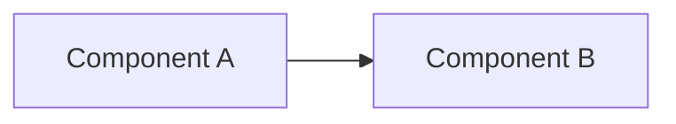

# <Short title of the architectural decision>

<!-- Copy this file to docs/adr/<NAME>.md and fill in every section. Delete guidance comments when done. -->

| Field | Value |
| :--- | :--- |
| **Document ID** | ADR-NNNN |
| **Title** | <One-line decision title> |
| **Status** | Proposed *(Proposed / Accepted / Rejected / Superseded / Deprecated)* |
| **Date** | YYYY-MM-DD |
| **Last updated** | YYYY-MM-DD |
| **Author** | <name> |
| **Reviewers** | <names> |
| **Approver** | <name / role> |
| **Approval date** | <YYYY-MM-DD or Pending> |
| **Decision drivers** | <the forces behind the decision: cost, latency, risk, compliance, team skills> |
| **Supersedes / Superseded by** | <ADR-NNNN or None> |
| **Related** | <links to specs, tickets, other ADRs> |

## Key Decisions

<!-- A scannable summary. One row per decision. -->

| # | Decision | Alternative considered | Why |
| :--- | :--- | :--- | :--- |
| 1 | | | |

## 1. Context and Objective

<!-- What problem is being solved, and what constraints apply? -->

## 2. System Overview

<!-- Diagram (Mermaid is fine) and short description of the components and data flow. -->

## 3. Detailed Design

<!-- Components, interfaces, data contracts, prompts, failure and retry behaviour. -->

## 4. Alternatives Considered

| Option | Pros | Cons | Verdict |
| :--- | :--- | :--- | :--- |
| | | | |

## 5. Security and Access

<!-- Authentication, authorization, secrets, data handling. -->

## 6. Observability and KPIs

| Metric | Target | Alert threshold | Action |
| :--- | :--- | :--- | :--- |
| | | | |

<!-- State whether targets are measured or proposed. -->

## 7. Consequences

- **Positive:**
- **Negative / trade-offs:**
- **Risks and mitigations:**

## 8. Known Limitations

<!-- Be explicit. List what the design does not do or does only partially. -->

## 9. Cost, Hosting and Dependencies

<!-- Models and versions, hosting, estimated cost, licences. -->

## 10. Next Steps / Open Questions

## Change Log

| Date | Author | Change |
| :--- | :--- | :--- |
| YYYY-MM-DD | | Initial draft |
